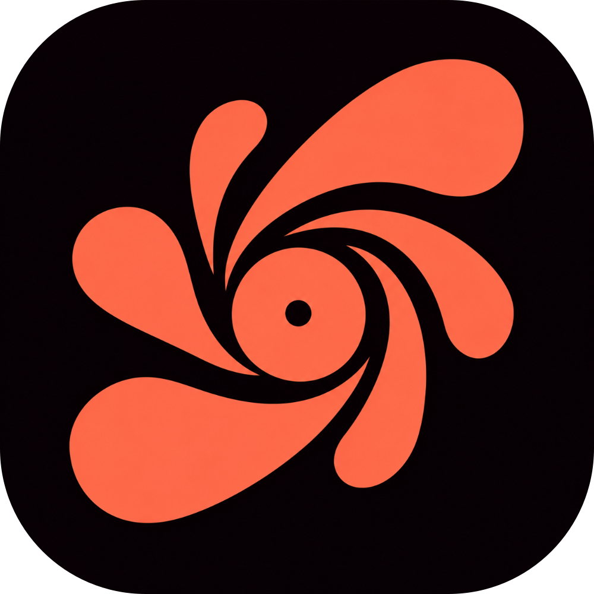
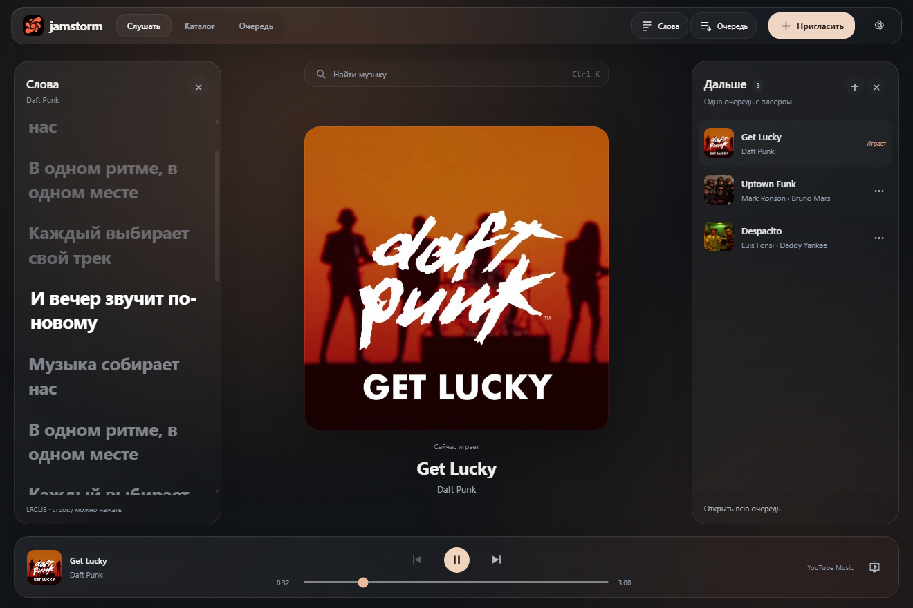

# JAMSTORM

**Собери своих. Включи громче.**



Неофициальный музыкальный клиент для Windows: YouTube Music на ПК, одна общая очередь, гости с телефона через браузер или Android Jam-Layer. Один portable EXE, без Node.js и без установки приложения гостями.

## Запуск

Скачай `JAMSTORM-0.5.1-portable.exe` из [Releases](../../releases). Windows x64; сборка не подписана цифровым сертификатом.

- **Слушать** — единая сцена с обложкой, словами, очередью и нижними контролами. **Слова** и **Очередь** циклически меняют вид: скрыто → сбоку → по центру. Центральный текст заменяет обложку и следует за активной строкой. **Найти музыку** или **Ctrl K** открывают поиск; выбор результата включает песню. **Каталог** открывает обычный YouTube Music с его аккаунтом и библиотекой. TV выбирается в настройках и открывается в отдельной рамке с навигацией. **Каталог** из TV переключает плеер на YouTube Music.
- **Пригласить** — сразу готовые ссылка и QR для гостей в одной Wi-Fi-сети. Они ищут музыку в YouTube, добавляют, удаляют и включают треки. Звук играет у хоста.
- **Включить доступ через интернет** — временная HTTPS-ссылка через встроенный cloudflared. На телефонах не нужны VPN, аккаунт JAMSTORM или приложение. ПК и комната должны оставаться включёнными. Cloudflare Quick Tunnels — экспериментальный сервис без гарантии доступности; адрес меняется после перезапуска.
- **Пригласить → Подключить Jam-Layer → Создать Android Jam на ПК** — отдельное приглашение для YouTube Music с совместимым Jam-патчем и Jam-Layer на Android. Нужна общая локальная сеть. Браузерные гости и Jam-Layer используют одну очередь JAMSTORM.
- **Подключиться к телефону** — полная ссылка `morphejam://join?...`. Музыка играет на телефоне, ПК управляет очередью. Браузерная комната требует хост на ПК.

Ссылка браузерной комнаты даёт управление очередью. Передавай её только участникам; закрытие комнаты отзывает доступ. Для Wi-Fi Windows может запросить доступ через брандмауэр. Некоторые DNS-фильтры блокируют `trycloudflare.com`. Локальная комната использует HTTP, интернет-ссылка — HTTPS. Интернет-запросы проходят через Cloudflare.

## Оформление и дополнения

Liquid Glass включён по умолчанию: стеклянные панели, собственная иконка, фиксированная верхняя панель. Материал и прозрачность переключаются в настройках. Учитываются системные настройки уменьшения анимации и прозрачности. Сцена прослушивания построена целиком в одном локальном DOM. Обложка ограничена по размеру и загружается в высоком разрешении; скрытие одной или обеих панелей не растягивает её на всё окно. Каталог и TV используют нативную геометрию своих сайтов, без наложения локальных панелей.

Дополнения выключены до явного включения:

- **SponsorBlock** — пропуск спонсорских вставок, саморекламы, просьб о взаимодействии и немузыкальных фрагментов. Для поиска сегментов отправляется префикс SHA-256 идентификатора видео. Данные: [SponsorBlock](https://sponsor.ajay.app), [CC BY-NC-SA 4.0](https://github.com/ajayyy/SponsorBlock/wiki/Database-and-API-License). Сегменты могут отсутствовать или быть неточными.
- **Базовая блокировка рекламы** — небольшой сетевой фильтр на Ghostery и нажатие доступной кнопки пропуска. Экспериментально; устранение всей рекламы YouTube не гарантируется.

Это встроенный каталог возможностей, без установки произвольного удалённого кода.

**Слова** и **Очередь** переключаются по кругу: скрыто → сбоку → по центру. Боковые панели могут работать одновременно; центр занимает одна из них. Центральный текст заменяет обложку, а маленькая обложка остаётся в нижнем плеере. LRCLIB ищет подходящую версию песни по названию, исполнителю и длительности; при отсутствии точного совпадения используется поиск. Синхронная строка выделяется и плавно перемещается; нажатие перематывает песню к строке. Название, исполнитель и длительность передаются LRCLIB, пока панель текстов включена. Доступны состояния загрузки, отсутствия текста, ошибки и повторной попытки. **F11** скрывает верхнюю панель; Escape возвращает окно.

Windows 11 22H2+ поддерживает нативные **Acrylic** и **Mica** через [системный материал Electron](https://www.electronjs.org/docs/latest/api/browser-window#winsetbackgroundmaterialmaterial-windows). На остальных системах используется непрозрачная основа. По умолчанию используется Mica с тёмной читаемой основой. Ambient выбирает цвет по обложке; переходы панелей используют View Transitions, обложка меняется с мягким появлением, фон медленно движется. Реакция на музыку анализирует отдельную копию локального MediaSource-потока, не заменяет аудиовыход и не использует микрофон. Если плеер не даёт захватить поток, остаётся статическое свечение. Движение света выключается в настройках и по системной настройке reduced motion. Лёгкая фактура не анимируется.

## Совместимость

TV-режим использует неофициальную совместимость Cobalt/Leanback. YouTube может изменить сайт. Встроенное подключение телефона по коду/QR зависит от доступности соответствующего интерфейса YouTube. JAMSTORM не является Chromecast-приёмником: автоматическое обнаружение ПК в меню Cast/DIAL пока не реализовано. Связка с физическим телефоном ещё требует ручной проверки.

**Известное ограничение preview:** в реальной проверке TV отклонял формат выбранного музыкального видео. Если запуск из очереди завершается ошибкой, приложение автоматически переходит на YouTube Music и сохраняет очередь. В этом режиме нативное TV pairing не работает. При первом открытии TV может потребоваться завершить его экран начала работы; отдельный аккаунт JAMSTORM не нужен. Полная проверка всех треков и состояний аккаунта не выполнена.

Очередь YouTube Music импортируется из самого плеера. Команды браузерных гостей и Jam-Layer направляются в нативную очередь; успех возвращается только после проверки изменения. Для начала включи хотя бы один трек в Music. Управление нативной очередью TV экспериментальное; при недоступности приложение сообщает ошибку вместо создания отдельной очереди. Это не обеспечивает синхронизацию с отдельным приложением YouTube на телефоне через Cast.

Для фонового воспроизведения отключено ограничение таймеров Electron, скрытие окна не передаётся YouTube как уход в фон. Ручная пауза сохраняется. Сон Windows, ограничения сети/аккаунта и ошибки YouTube это не отменяет.

Android: приглашения v1/v2, прямые приватные IP, IPv4 MJP2 discovery, AES-256-GCM, проверка последовательности, идемпотентные команды. Нет коротких кодов/J-PAKE, Bluetooth, Wi-Fi Aware, резервного канала и автоматического переподключения. Приглашение живёт 12 часов; до 500 треков и 16 соединений. Обычного ReVanced без Jam-патча недостаточно. Интернет-туннель предназначен для браузерных гостей, а не Android-протокола Jam-Layer.

Вход Google и все сочетания аккаунтов, TV pairing и Android ReVanced на физических устройствах не проверены. Одновременного синхронного звука на телефонах нет: аудио воспроизводит только хост. Доступность треков определяется YouTube.

## Разработка

Node.js 22+, Windows x64:

```powershell
npm ci
npm run tunnel:fetch
npm run check
npm test
npm start
npm run build
```

Сборка: `dist/JAMSTORM-0.5.1-portable.exe`. cloudflared закреплён версией и SHA-256 в `scripts/fetch-tunnel.cjs`. Его бинарник не хранится в git; лицензия включена. Иконки уже в `assets`; генератор `scripts/icons.cjs` запускается через Electron с удалённым `ELECTRON_RUN_AS_NODE`.

`npm run smoke` проверяет UI, IPC и неподвижность верхней панели. `node scripts/run.cjs --live-smoke-test --music-mode` проверяет настоящий Music, гостевой HTTP → нативную очередь, синхронные тексты, геометрию, анализ звука и фон. `npm run smoke:live` сохраняет экспериментальную TV-проверку. `scripts/room-smoke.cjs` проверяет мобильную гостевую страницу; флаг `--internet` временно публикует только тестовую комнату и закрывает туннель после проверки.

Тесты протокола работают без Android. Дополнительный Java-тест в обоих направлениях запускается, если отдельно получить Jam-Layer в `upstream/Jam-Layer` и установить JDK 21+. Чужие Android-исходники не входят в репозиторий или релиз.

`scripts/ui-review.cjs` снимает 19 состояний оболочки на управляемых данных: четыре комбинации панелей, 860/1320/1920px, поиск, приглашение, настройки и изоляцию TV. Дополнительно проверяются 40 сочетаний коротких окон, пустого/заполненного плеера и размещения панелей: кликабельность поиска, полная видимость кнопки, центр текущей строки и фактический запуск анимаций. Скриншоты сохраняются локально в `artifacts/ui-review`. Тестовые данные не входят в приложение.

Визуальные ориентиры: [CloudMus](https://github.com/cloudmus/cloudmus) и настольные музыкальные плееры. CloudMus использует Qt/C++; его код и ресурсы не включены в эту HTML/CSS-реализацию. Приложение сохраняет прежний движок YouTube/Jam.

## Права и приватность

Оригинальный код и знак JAMSTORM — MIT, Copyright © 2026 JAMSTORM contributors. Лицензии зависимостей и авторство сохранены: [THIRD_PARTY_NOTICES.md](THIRD_PARTY_NOTICES.md), `assets/licenses`, лицензии Electron/Chromium внутри сборки. MIT-лицензия проекта не меняет лицензии стороннего кода и данных.

Программа загружает сайт YouTube во время работы. Музыка, видео, APK, закрытый код Google и данные аккаунтов не распространяются с исходниками. Cookies остаются в профиле Electron на ПК; гостям они не передаются. Поиск гостей выполняется анонимным запросом к YouTube на ПК-хосте. Своего сервера аналитики и аккаунтов JAMSTORM нет.

Проект не связан с Google, YouTube, ReVanced, Jam-Layer, Cloudflare или SponsorBlock. Их названия принадлежат соответствующим правообладателям. Условия YouTube и сторонних сервисов продолжают действовать. Открытая лицензия и опциональные дополнения не являются обещанием отсутствия юридической ответственности или претензий.
