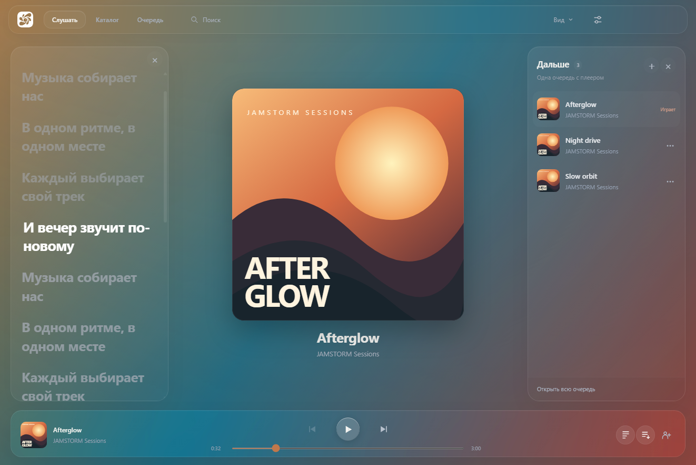
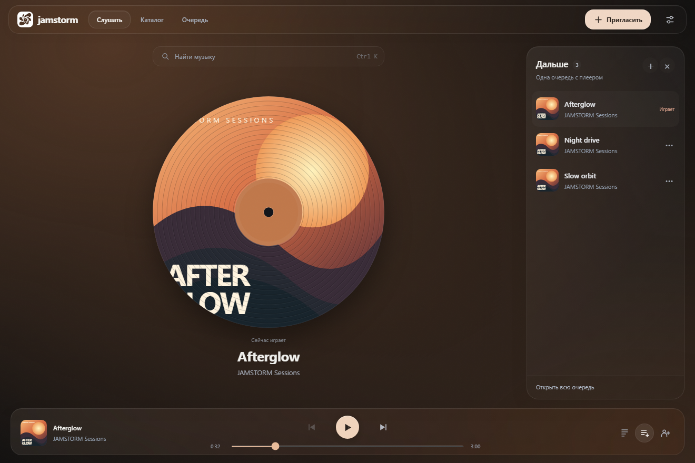
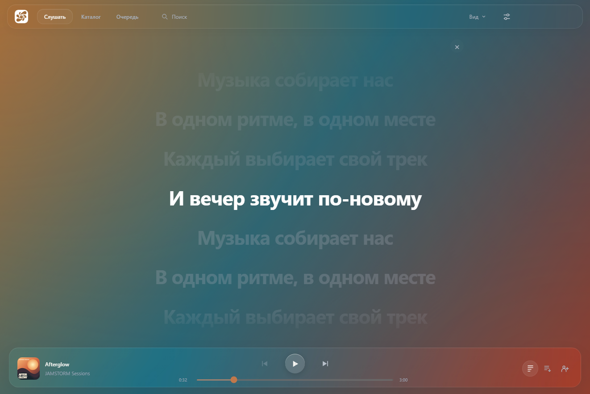

<h1 align="center">JAMSTORM</h1>

Твоя музыка. Ваша очередь.

<a href="https://github.com/svyatoslavpodolskii/JAMSTORM/releases/download/v0.7.5/JAMSTORM-0.7.5-setup.exe">Скачать для Windows</a> · <a href="#слушайте-вместе">Слушать вместе</a> · <a href="docs/USER-GUIDE.md">Как пользоваться</a>

Музыкальный плеер для Windows с YouTube Music, стеклянным интерфейсом и общей очередью. Установи в выбранную папку, найди песню, пригласи друзей. Профиль и настройки хранятся рядом с приложением в папке data. На телефоне достаточно браузера.

### Музыка в центре

Обложка или вращающаяся пластинка. Винил плавно разгоняется, замедляется к концу песни и меняется вместе с треком. Бумажную этикетку в цвет альбома можно отключить. Фон подхватывает палитру обложки и реагирует на звук.

Текст и очередь переключаются **сбоку → по центру → скрыть**. Центральный текст следует за текущей строкой. Очередь меняется перетаскиванием. В полном экране остаются компактные кнопки навигации.

| Винил | Текст в центре |
|:--:|:--:|
|  |  |

### Слушайте вместе

1. Включи песню через поиск или каталог YouTube Music.
2. Нажми **Пригласить** и отправь ссылку или QR.
3. Друзья ищут музыку и добавляют её в ту же очередь. Звук играет на твоём ПК.

Для одной Wi-Fi-сети всё готово сразу. Для друзей через интернет включи временную ссылку в приглашении — без VPN и установки приложения. Совместимый Android Jam-Layer подключается отдельным приглашением по локальной сети.

### По твоим правилам

В настройках комнаты — лимит несыгранных песен на участника и режим, в котором гости могут только добавлять в конец очереди. **Фильтр E** сохраняется на хосте: отмеченные Explicit треки отклоняются перед добавлением, убираются из очереди и пропускаются. Если маркировку проверить не удалось, добавление отклоняется. Результат зависит от метаданных YouTube, а не от анализа аудио.

**Ctrl K** работает и на русской раскладке. **F11** включает полный экран. В меню **Вид** — шесть готовых пресетов, свои сохраняемые варианты, тема, прозрачность, фон и зерно. Оформление применяется и к каталогу YouTube Music. Материал окна, винил, этикетка, свет и дополнения находятся в настройках. Новые версии проверяются автоматически; установка и перезапуск запускаются кнопкой в настройках. Нативное стекло требует Windows 11 22H2 или новее; остальной интерфейс работает без него.

### Preview

Основной режим — YouTube Music. YouTube TV экспериментальный: физический Cast/pairing и все варианты аккаунтов не подтверждены. Кнопка Google Cast не превращает ПК в Chromecast; доступен переход в браузер. Интернет-комната использует Cloudflare Quick Tunnels и требует включённого ПК. Сборка Windows x64 не подписана цифровым сертификатом.

На скриншотах — собственная демонстрационная обложка и оригинальный тестовый текст.

---

Неофициальный независимый проект, не связанный с Google или YouTube. [MIT](LICENSE) · [Лицензии зависимостей](THIRD_PARTY_NOTICES.md) · [Приватность и ограничения](docs/USER-GUIDE.md#приватность) · [Для разработчиков](docs/DEVELOPMENT.md)
